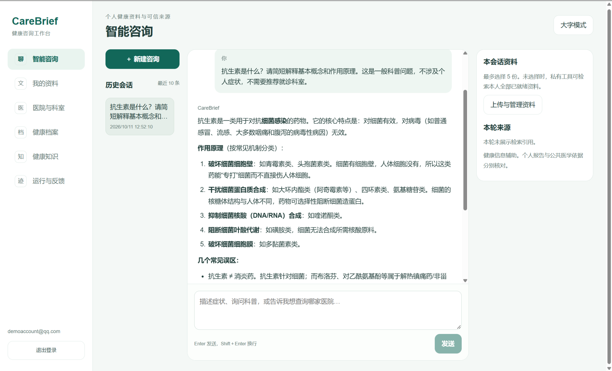
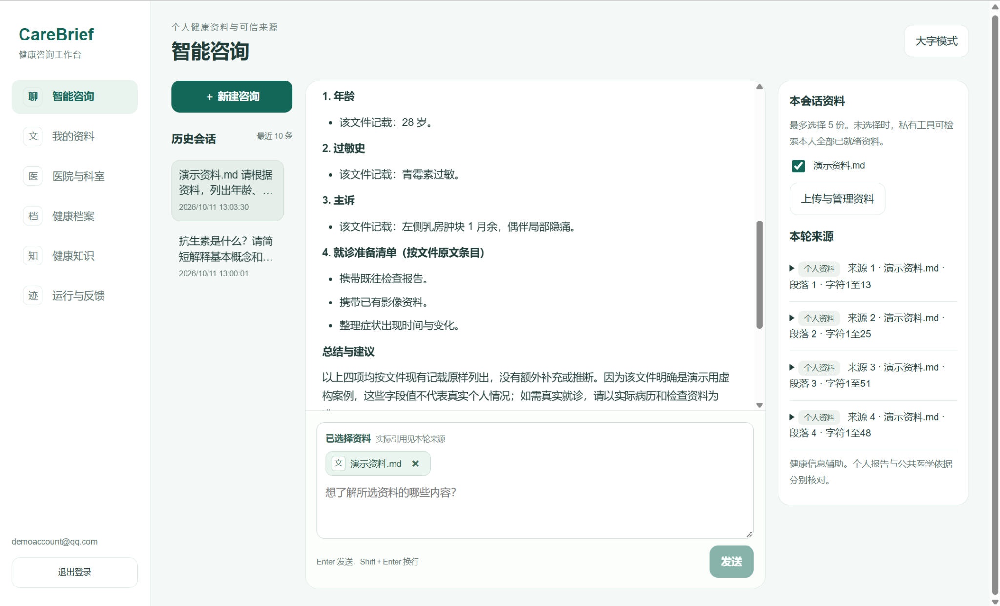
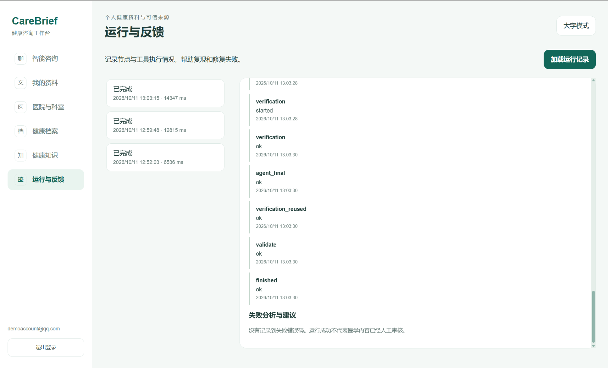

# CareBrief Agent

面向健康信息咨询和就诊方向参考的 AI Agent 工程项目。

## 版本状态

正在整理首个版本 `v0.1.0`。本仓库已初始化发布说明、上传排除规则和用于本机验证的前后端 Docker 配置。核心应用源码、依赖清单和后端配置示例已上传；正式镜像尚未发布。用户已在本机完成前后端镜像构建；后端核心依赖导入和容器网络数据库连接检查已通过，用户随后反馈后端容器启动与工作台功能验证通过。功能描述对应开发中的本地项目，不代表仓库已经具备完整运行条件。

## 项目能力

- 多轮健康信息咨询、基础科普和一般就诊方向参考。
- PostgreSQL / pgvector 公共知识检索，结合向量召回、关键词召回、查询规划与重排。
- 由大模型通过 Function Calling 选择工具，检索本地资料、发现网页并读取外部来源；浏览器读取作为可选兜底。
- 用户文档选择与引用，以及个人健康信息候选提取、确认和冲突处理。
- 对话上下文压缩与摘要持久化。
- Agent 运行事件、失败分析与回归测评。
- 前端停止生成、当前回答复制和反馈入口。

外部信息获取取决于检索服务配置、网站可访问性和页面内容，不能保证任意问题都能取得完整资料。

## 技术组成

| 部分 | 技术 |
| --- | --- |
| 前端 | Next.js / React / TypeScript |
| 后端 | Python / FastAPI |
| Agent 编排 | LangGraph / Function Calling |
| 公共知识存储 | PostgreSQL / pgvector |
| 模型服务 | DeepSeek 与配置的 Embedding 服务 |
| 可选网页读取 | Crawl4AI / Playwright |

最终依赖版本和部署方式以随后提交的代码与配置为准。

## 发布范围

GitHub 保留运行所需源码、依赖声明、配置示例、数据库初始化或迁移文件、必要测试和部署说明。

真实 API 密钥、账号凭据、个人上传文档、健康档案、数据库备份、测评原始对话、虚拟环境、依赖目录与本地缓存不随项目发布。公共知识数据须确认来源与再分发条件后单独整理。

容器镜像计划通过 GitHub Container Registry 发布；镜像构建与启动验证通过前，不创建正式版本标签。Docker 构建还需要独立的构建上下文排除规则，不能只依赖 `.gitignore`。

## 当前验收边界

长对话测试曾完成 24 轮请求，但部分回答依赖输出修复；实际计费 Token 节省尚未验证。后续需要继续检查首次输出成功率、检索超时、引用一致性和重启后的摘要恢复。

当前停止生成采用进程内任务管理，部署先使用单个后端工作进程；多进程取消协调尚需完善。

本项目提供健康信息辅助，不替代医生诊断、处方或急诊评估。

## 前端镜像的本机验证

将本仓库 `apps/web/Dockerfile` 和 `apps/web/.dockerignore` 应用到现有完整项目后，在项目根目录执行：

```powershell
docker build --progress=plain --build-arg NEXT_PUBLIC_API_BASE_URL=http://127.0.0.1:18000 -t carebrief-web:0.1.0-check ./apps/web
```

当前仓库已包含前端源码和锁文件。用户反馈从独立发布目录重新构建前后端镜像成功；新数据库环境的运行验证仍待完成。用户已在 Docker Desktop Linux 模式下完成前端镜像构建；用户反馈容器版工作台功能验证通过。

该配置适用于当前未提供自定义 `next.config.*` 的情况；添加运行时配置后需同步调整镜像。浏览器使用的 `NEXT_PUBLIC_API_BASE_URL` 在构建时写入，修改地址后需要重新构建。静态资源通过 `public` 目录复制到运行镜像。

停止占用 3100 端口的原前端开发服务后，可运行：

```powershell
docker run --rm --name carebrief-web-check -p 127.0.0.1:3100:3000 carebrief-web:0.1.0-check
```

使用 `http://127.0.0.1:3100/workspace` 验证工作台，使用 `http://127.0.0.1:3100/workspace?tab=runs` 验证运行与反馈页面。后端使用 18000 端口；可按下面的启动助手切换为容器运行，切换前停止原本机后端。

## 核心后端镜像的本机验证

当前 Dockerfile 安装混合检索、文档入库、工作台和网页工具的依赖清单，并通过它们递归安装基础依赖。不安装开发测试、PaddleOCR 或 Crawl4AI 的额外环境；默认 `CRAWL4AI_ENABLED=false`。浏览器兜底与 OCR 需要后续配置并单独验收，当前镜像不代表这些能力已经完成容器化。

构建会复制应用代码、脚本与公共知识种子 `data/knowledge.json`。个人档案、上传资料、SQLite 文件与本地缓存不随镜像复制；其他公共资料需要在整理发布清单后另行处理。

将配置应用到已有完整项目，在项目根目录执行：

```powershell
docker build --progress=plain -t carebrief-api:0.1.0-check ./apps/api
docker run --rm --entrypoint python carebrief-api:0.1.0-check -c "import fastapi, langgraph, sqlalchemy, psycopg, pgvector, jieba, docx; print('core dependencies OK')"
```

依赖导入检查不会启动应用，也不证明数据库、登录、检索或模型 API 已经通过联调。

完整启动前须核对容器内的数据库地址、缓存与文档路径、运行时密钥注入、CORS 和数据持久化挂载。当前仅使用一个 Uvicorn 工作进程。既有 Windows 虚拟环境路径不能直接用于 Linux 容器。

当前 GitHub 仓库已包含核心应用源码、依赖清单与初始 knowledge.json 种子。完整医院目录和额外知识正文尚未发布；正式镜像、版本标签与 GHCR 发布待独立部署验收后进行。

## 后端运行配置与启动助手

`apps/api/scripts/prepare_docker_runtime.py` 从本机 `apps/api/.env` 生成私有的 Docker 配置，不修改原文件。它将 RAG 数据库地址转换为数据库容器名称与内部 5432 端口，将支持的存储路径转换为 `/app/.cache` 或 `/app/data`，加入工作台 3100 的 CORS 配置。遇到挂载范围外的存储路径会停止并报告字段名称。

生成的 `.cache/docker-runtime/api.env` 与 `api.dotenv` 含运行凭据，仅用于本机运行，不能上传仓库或发给他人。

先停止原本机 Uvicorn 服务，保持现有数据库和前端容器运行。将启动助手下载到完整本地项目对应位置后，在项目根目录执行：

```powershell
powershell.exe -NoProfile -ExecutionPolicy Bypass -File .\apps\api\scripts\start_docker_api.ps1
```

启动助手使用现有 `carebrief-api:0.1.0-check` 镜像，自动获取 `ai-consultation-v1-rag-db-1` 的自定义网络，将现有 `.cache`、`data` 目录挂载到容器，发布 `127.0.0.1:18000`，并检查 `/openapi.json`。如同名容器或端口已经存在，会停止而不会自动删除。

配置转换的 8 项自动测试已通过。用户已在 Windows 环境运行启动助手，HTTP 就绪，并反馈工作台功能验证通过。以上为本机验证记录，完整源码发布后的干净环境部署仍需另行验收。浏览器兜底和 OCR 尚未在这个核心镜像中启用。

## 源码发布准备

`apps/api/scripts/prepare_source_release.py` 可将现有完整项目中的指定源码、依赖声明、测试和部署配置复制到独立的 Git 克隆目录。它不会提交、推送或修改原项目文件；保留克隆目录中已审阅的 Dockerfile 与排除规则。

脚本排除虚拟环境、缓存、上传资料、备份和运行结果，数据仅复制 `data/knowledge.json`。额外医院目录、原始正文、测评数据和静态资源需要单独核对后补充。自动扫描会对识别出的密钥或数据库密码暴露停止复制，仅报告文件与行号；这不能替代对个人信息和数据再分发权限的人工核对。

准备脚本的 11 项测试已通过。路径检查已修正，不再将 http/https URL 误认为 Windows 盘符。本机发布清单保存在原项目的 `.cache/release-review`，不随源码上传。完成文件审阅、补齐必要资源和干净环境验证后再提交正式版本。

## 统一 Compose 配置（待干净环境联调）

根目录 `compose.yaml` 统一使用 pgvector PostgreSQL 17，API 通过 `rag-db:5432` 连接公共知识与工作台数据库。会话数据库暂保持 SQLite，摘要、会话和上传目录使用独立命名卷。默认主机端口为 API 18000、工作台 3100；可通过 `release.env.example` 中的端口变量调整。

该配置需要 Docker Compose 2.24.0 或更新版本，因为 API 环境文件设置为可选。真正启用 live 模式前，仍需配置 API 环境文件、核对其余存储路径、初始化数据库并建立知识索引。示例密码仅用于配置校验，实际部署须使用新生成的字母数字密码（数据库 URL 当前直接插入该值）。

仅校验配置、不启动或修改容器：

```powershell
docker compose --env-file release.env.example -p carebrief-release -f compose.yaml config --quiet
```

YAML 解析和服务引用已检查；用户反馈 Docker Compose 配置校验返回 0；干净环境部署尚待完成。不能据此认为医院目录、私有文档、浏览器兜底或整个发布流程已完成验收。

## 配置文件说明

| 文件 | 复制目标 | 用途 |
| --- | --- | --- |
| `release.env.example` | 根目录 `.env` | 统一 Compose 的新数据库密码和主机端口 |
| `apps/api/.env.example` | `apps/api/.env` | 模型、Embedding、可选外部检索和后端功能配置 |
| `apps/web/.env.local.example` | `apps/web/.env.local` | 本机前端开发时的 API 地址 |
| `apps/api/workspace.env.example` | 按需合并到后端 `.env` | 工作台高级配置参考 |
| `apps/api/crawl4ai-integration.env.example` | 按需合并到后端 `.env` | 可选浏览器读取参考，核心镜像暂未启用 |

后端统一示例 apps/api/.env.example 已由用户在本机生成、核对并上传。生成器 `apps/api/scripts/generate_env_example.py` 从应用代码识别 `os.getenv` 等配置字段，并参考现有配置的字段名称、公开模型名称和可信提供商地址。密钥、密码、管理员邮箱及 Windows 绝对路径不会复制；未知字段保持注释。输出不是实际凭据文件，也不修改现有 `.env`。生成器的 5 项测试已通过，实际项目输出还需核对。

发布目录已有源码时，可在本机执行（将 `<existing-api>` 替换为现有后端目录）：

```powershell
<existing-api>/.venv/Scripts/python.exe apps/api/scripts/generate_env_example.py --api-root apps/api --reference-env <existing-api>/.env --output apps/api/.env.example
```

正式使用时，在没有实际配置文件的情况下复制示例：

```powershell
Copy-Item release.env.example .env
Copy-Item apps/api/.env.example apps/api/.env
Copy-Item apps/web/.env.local.example apps/web/.env.local
```

根目录 `.env` 的 `RELEASE_POSTGRES_PASSWORD` 必须改为新生成的字母数字密码；不能直接用示例占位符部署。后端 live 模式需填写 DeepSeek 与所选 Embedding 服务的真实密钥；只有启用相应外部检索时才需要填其检索密钥。生成的示例沿用实际代码的字段名，勿另造别名。浏览器和 OCR 的依赖环境仍需单独配置。

统一 Compose 会覆盖后端的 RAG 地址、会话数据库地址和关键存储路径；本机直接启动后端时，须将示例 RAG URL 中 `CHANGE_ME` 改为自己数据库的密码。根目录变量用于 Compose 插值，后端 `.env` 用于 API 服务；两者不是同一个配置文件。原有 `compose.rag.yml` 是单独数据库的开发配置，不与统一配置同时启动。

前端本机开发应将 `NEXT_PUBLIC_API_BASE_URL` 设置为 `http://127.0.0.1:18000`；Compose 构建时通过构建参数提供该地址。改变该公开变量后需重新构建前端。

可以先运行 `docker compose --env-file .env -p carebrief-release -f compose.yaml config --quiet` 校验配置，不输出凭据值。新数据库尚需工作台表初始化和知识入库/索引构建；完整初始化顺序在源码同步并完成独立部署验收后补充，不应把当前配置示例视为完整部署已经通过。

## 界面展示

### 工作台与基础科普
支持自然语言健康信息问答。



### 文件问答与来源引用
勾选上传文件后，整理文档内容并展示段落来源。截图使用虚构演示资料。



### Agent 运行记录
展示执行状态、最终校验结果和单轮耗时。运行成功不代表医学内容已经人工审核。


